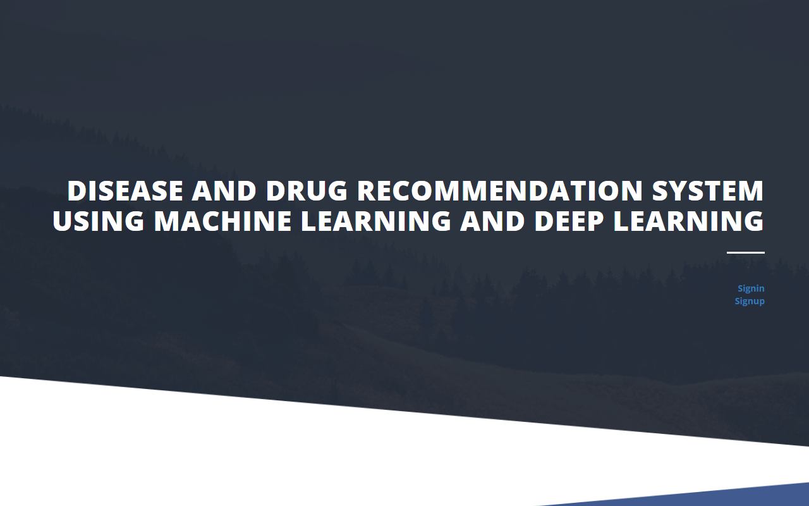
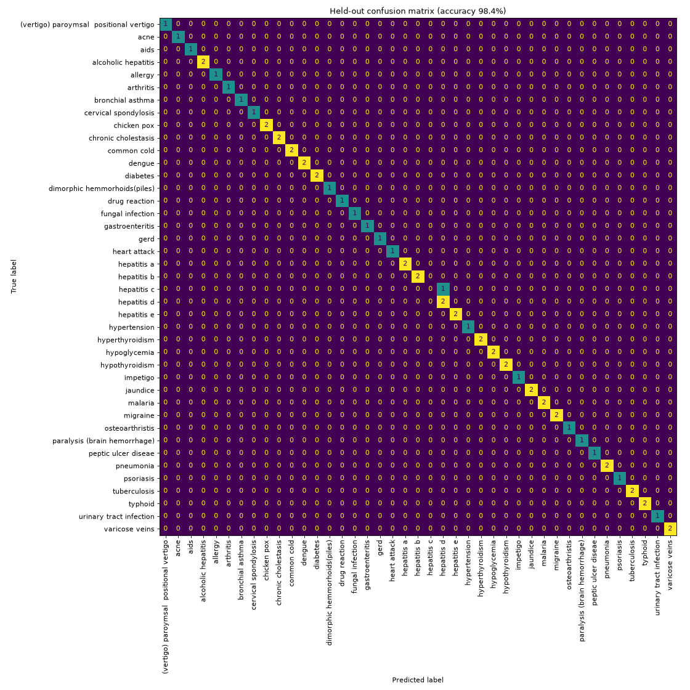
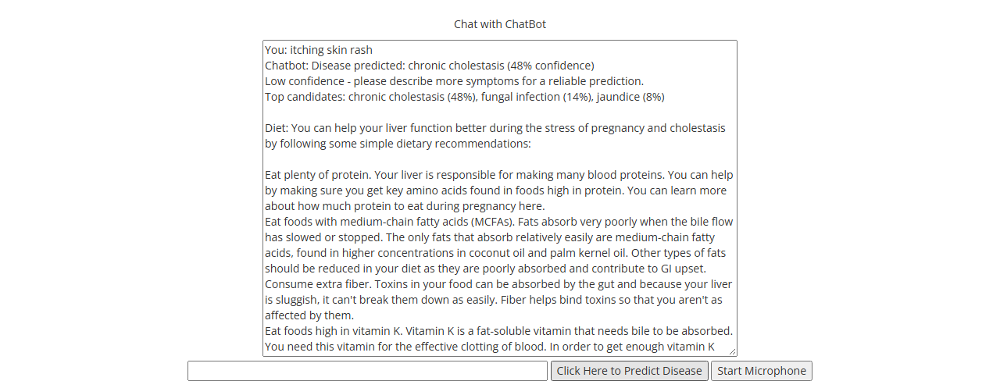

# Disease & Drug Recommendation System

A Flask web app where users describe their symptoms, typed or spoken, to a chatbot. A
**CNN trained on TF-IDF symptom features** predicts the most likely of **41 diseases** and
returns a diet plan and common medications for it.

Built as my final-year (BE) major project.



## Results

| Metric (held-out test set) | Score |
|---|---|
| Accuracy | **98.4%** |
| Macro F1 | **0.971** |
| Classes | 41 diseases |

The raw dataset has 4,920 rows but only **304 unique symptom sets**, because the same rows repeat many
times. If you split the raw data randomly, copies of the same row end up in both train and test,
and every model scores a misleading 100%. `train.py` removes duplicates *before* a stratified
80/20 split, so these numbers come from symptom combinations the model never saw.



The only error on the test set is hepatitis C predicted as hepatitis D. The two have nearly identical symptom profiles.

## Features

- **Symptom chatbot.** Type symptoms or use the microphone (Web Speech API).
- **Disease prediction with confidence.** Shows the top 3 candidates, and asks for more symptoms when confidence is below 50%.
- **Diet & medication recommendations** for each predicted disease.
- **User accounts.** Sign up / sign in with salted password hashes (scrypt via Werkzeug), session-based auth, protected routes.
- **Notebook view.** The exploratory notebook (model comparison: Random Forest, KNN, SVM, Gradient Boosting, Voting, CNN) is viewable in the app.



## How it works

```
symptoms text ──► clean (lowercase, stopwords, lemmatize) ──► TF-IDF vector
              ──► CNN: Conv2D(32,1x1) → Conv2D(32,1x1) → Dense(256) → Dropout → Softmax(41)
              ──► disease + confidence ──► diet file + medication lookup
```

The TF-IDF vector is reshaped into an `(n_features × 1 × 1)` tensor, so the 1×1 convolutions
learn feature-wise transformations before the dense classifier.

## Tech stack

Python · TensorFlow/Keras · scikit-learn · NLTK · Flask · SQLite · HTML/CSS/JS

## Run it locally

Requires **Python 3.10–3.12** (TensorFlow doesn't support newer versions yet).

```bash
git clone https://github.com/karnasanjana/disease-drug-recommendation.git
cd disease-drug-recommendation
python -m venv .venv
.venv\Scripts\activate          # macOS/Linux: source .venv/bin/activate
pip install -r requirements.txt

python app.py                   # open http://127.0.0.1:5000
```

A trained model is included in `model/`. To retrain it and regenerate the metrics and confusion matrix:

```bash
python train.py
```

Example inputs are in [`testcases.txt`](testcases.txt).

## Project structure

```
├── app.py               # Flask routes, auth, prediction endpoint
├── train.py             # dedupe → split → train/evaluate CNN → save model
├── preprocess.py        # text cleaning shared by training and inference
├── recommendations.py   # medication lookup + diet files
├── model/               # trained CNN, TF-IDF vectorizer, metrics.json
├── Dataset/dataset.csv  # disease → symptoms
├── diets/               # diet recommendations per disease
├── Notebook.ipynb       # EDA and model comparison
├── templates/ static/   # frontend
└── docs/                # screenshots, confusion matrix
```

## Limitations

- Small dataset (304 unique symptom sets), so the model only knows the symptom vocabulary it was trained on.
- Diet and medication suggestions are static lookups, not personalized.

> **Disclaimer:** This is an academic project and **not** a medical tool. Always consult a qualified doctor.
